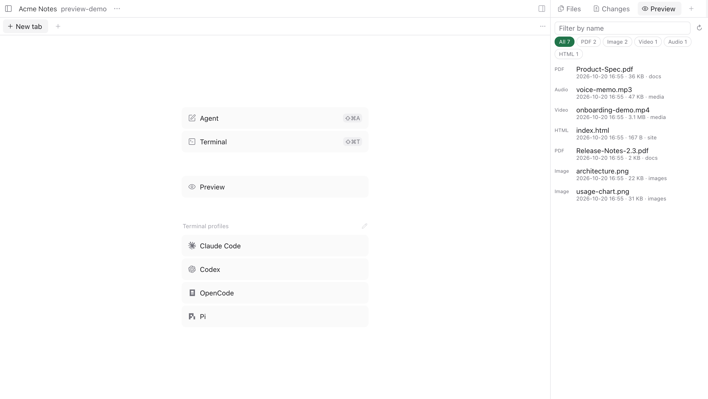
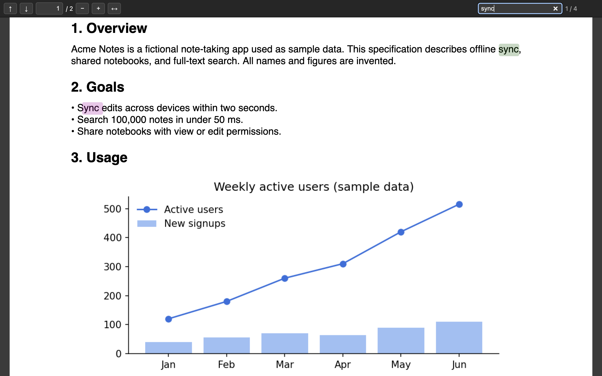

# Paseo file preview

Preview PDFs, images, video, audio, and HTML from a Paseo workspace. Paseo's file panel shows "binary preview unavailable" for these files ([getpaseo/paseo#3720](https://github.com/getpaseo/paseo/issues/3720)). This plugin adds a **Preview** panel that lists them newest first. Selecting one opens it in a Paseo browser tab.





- **PDF:** a bundled [pdf.js](https://mozilla.github.io/pdf.js/) viewer with page navigation, zoom, fit to width, full-text search (`⌘F`), and password prompts. Korean, Chinese, and Japanese PDFs render with the bundled CMaps. Paseo's in-app browser shows Chromium's own PDF viewer as a blank page, so pdf.js is required.
- **Images, video, audio:** open in a minimal player page (Paseo's browser tab shows a bare media file as a blank page). HTTP Range support lets video and audio seek.
- **Mobile app and remote clients:** PDFs and images open inside the panel. Image bytes and rendered PDF pages travel over plugin RPC, the only channel that crosses Paseo's relay. Long-press a PDF or image to use this view on desktop too.
- **HTML:** opens as is. Relative links resolve to sibling files. Pages run sandboxed and can still load HTTPS resources, as any web page can.

## Install

Requires Paseo 0.11.1 or newer, plugins enabled on the daemon host, and npm on that host so installation can fetch pdf.js (without it, PDFs cannot open but other files still preview). Plugins run trusted code on the daemon host; review the source before installing.

```bash
paseo plugin add git:gil-pingping/paseo-file-preview
paseo plugin ls file-preview
```

Then open the right-hand panel's `+` menu in a workspace and choose **Preview**. The UI follows the system language (English or Korean).

## How it works

- `preview.list` scans the workspace directory, skipping hidden entries, symlinks, and build folders (`node_modules`, `dist`, `build`, `venv`, `target`, and similar). It returns the 5,000 most recently modified previewable files and stops after visiting 200,000 directory entries. Both RPCs take a Paseo workspace ID; the server looks up the directory through the Paseo API instead of trusting a client-supplied path.
- `preview.open` starts a Node HTTP server on `127.0.0.1` with a random port and a random 128-bit URL token, then returns a URL that the panel opens with Paseo's `openBrowser`. URLs are created when you select a file, so they stay valid after a plugin reload.
- Before opening a tab, the panel requests `/<token>/ping` on that URL. If it fails, the client is not on the daemon's computer, so PDFs and images open inside the panel instead.
- `preview.read-image` returns an image in 384 KB chunks (20 MB limit). `preview.pdf-info` and `preview.pdf-page` render PDF pages to JPEG in `server/pdf-worker.mjs`, a child process run with the system `node`. Paseo Desktop's plugin runtime on macOS is a hardened, signed Electron helper that refuses to load third-party native addons such as `@napi-rs/canvas`, which pdf.js needs to rasterize pages.

## Security

Workspace files can be untrusted, for example in cloned repositories or downloaded PDFs.

- The server answers only requests whose `Host` is `127.0.0.1:<port>`, which blocks DNS rebinding.
- Each workspace gets its own secret token. A URL serves a file only if its real path, after resolving symlinks, is inside that token's workspace.
- Only previewable types and their page assets (CSS, JS, fonts) are served. Other files such as `.env` or keys are refused.
- Workspace files are served with `Content-Security-Policy: sandbox` (no `allow-same-origin`), `default-src 'self' https:`, `form-action 'none'`, `nosniff`, and `no-referrer`. Scripts in a previewed HTML or SVG file run in an opaque origin, so they cannot read other files or reach other localhost services such as the Paseo daemon.
- The PDF viewer page has a strict nonce-based CSP, and pdf.js runs with `isEvalSupported: false`.

## Limits

- Video, audio, and HTML preview need Paseo Desktop on the daemon's computer. The preview server listens on the daemon host's `127.0.0.1`, and Paseo's `openBrowser` opens URLs in the client's own webview without tunnelling them. On mobile and remote clients only PDFs and images are available, inside the panel, without text search.
- PDF rendering for the panel needs the system `node` on the daemon host.
- Paseo plugin panels cannot embed web pages, so previews open in a separate browser tab, not inside the file tab.
- Office documents are not supported. HTML that loads JavaScript modules or fetches its own files fails inside the sandbox.
- Tested on macOS with Paseo 0.11.1. Windows paths are handled but untested.

## Develop

```bash
npm ci
npm run typecheck
npm test
paseo plugin install "$PWD"   # local development install
```

Server code lives in [`server/`](server), the panel in [`client/panel.tsx`](client/panel.tsx), and RPC contracts in [`shared/preview.ts`](shared/preview.ts). See [`OVERVIEW.md`](OVERVIEW.md) for the in-app description.
